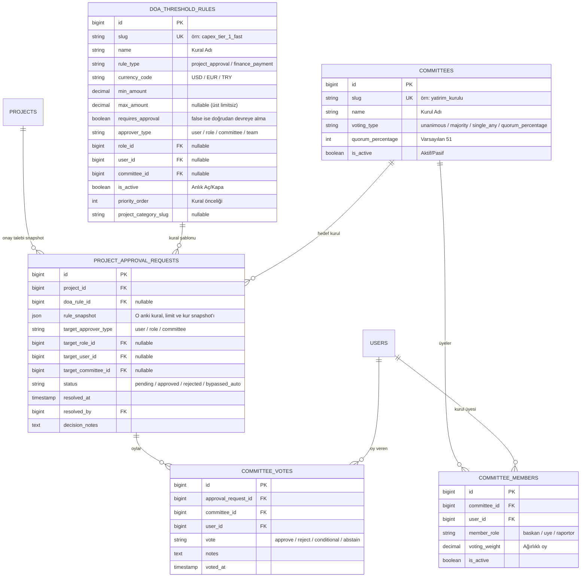

# Dinamik Bütçe Onay Kademeleri (DOA Matrix) & Kurul Yönetim Mimarisi Uygulama Planı

Bu belge, Köksan Enterprise PPM sistemi için **Dinamik Yetki Devri (Delegation of Authority - DOA)**, **Çok Kademeli Bütçe Eşik Motoru**, **Kurul / Komite Oylama Sistemi** ve bunların mevcut **Yetki, Bildirim, Sayfa Erişimi ve Denetim Logu Matrisleri** ile tam entegrasyon mimarisini tanımlar.

---

## 1. Temel İlkeler ve Sistem Felsefesi

1. **Sıfır Hardcode (No-Code Mimarisi)**:
   - Kod tabanında hiçbir sabit bütçe rakamı (`$budget > 1000000`), sabit kullanıcı ID'si veya sabit rol kısıtlaması bulunmaz.
   - Tüm bütçe kademeleri, kurallar, limitler, onaycılar ve kurullar veritabanı üzerinden dinamik **slug kodlar** ile yönetilir.

2. **n-Tane Kural ve Katman (Sınırsız Kademe)**:
   - İster 2 kademe, ister 15 kademe tanımlanabilir.
   - Proje başlangıç bütçesi onayı, finans ödeme onayı, revizyon bütçesi onayı gibi farklı kural tipleri (`rule_type`) desteklenir.

3. **Anlık Açma / Kapatma (Global & Kural Bazlı Switch)**:
   - Tüm DOA mekanizması tek bir anahtarla (`doa_budget_approval_engine_active`) anında devre dışı bırakılabilir veya devreye alınabilir.
   - Her bütçe kademesi / kuralı bağımsız olarak `is_active` anahtarıyla açılıp kapatılabilir.

4. **Tarihsel Değişmezlik (Snapshot Mekanizması & Geçmiş Projelerin Korunması)**:
   - *"O an olan olmuştur. Kural değişince geçmiş etkilenmez."*
   - Bir proje onaya sunulduğunda, o an yürürlükte olan bütçe kuralının, onaycılarının ve döviz kurlarının tam bir anlık kopyası (`rule_snapshot`) oluşturulur ve `project_approval_requests` tablosuna kaydedilir.
   - Gelecekte bir kural değiştirilse, silinse veya limitleri güncellense dahi, geçmişte onaylanmış veya o an onay bekleyen projeler bu değişiklikten asla etkilenmez.

5. **Kurul, Takım ve Grup Yönetimi (Committees & Voting)**:
   - Onay yetkisi sadece tekil kullanıcıya veya role değil; **Kurullara (Yatırım Kurulu, İSG Kurulu vb.)** ve **Takımlara/Gruplara** verilebilir.
   - Kurullar için esnek oylama modelleri tanımlanır:
     - `unanimous`: Oy birliği (Tüm üyeler onaylamalı)
     - `majority`: Oy çokluğu (%50 + 1)
     - `single_any`: Herhangi bir kurul üyesinin onayı yeterli
     - `quorum_percentage`: Belirlenen nisap oranına (%X) ulaşılması

6. **Log Görünürlük Matrisi ve Hiyerarşi Ayrımı**:
   - `developer` (`superadmin`): Developer tarafından yapılan kural, sistem ve yetki değişiklik loglarını **SADECE DEVELOPER** görebilir.
   - `admin`: Admin tarafından yapılan kural, onay ve kurul yönetim loglarını **ADMIN, DEVELOPER ve YÖNETİM** görebilir.
   - Yeni modüller (`doa`, `kurul_yonetimi`, `butce_onay`) `/admin/denetim-loglari` sayfasındaki Log Görünürlük Matrisine entegre edilir.

7. **Matris Entegrasyonları**:
   - **Bildirim & Mail Matrisi**: Kurul oylaması, eşik onayı, otomatik hızlı onay gibi olaylar `notification_matrix` üzerinden yönetilir. Dinamik alanlar zorunlu olarak **KALIN** (`**...**`) yazılır.
   - **Yetki Matrisi**: `manage_doa_rules`, `manage_committees`, `vote_in_committee` izinleri Spatie / Permission matrisinde yer alır.
   - **Sayfa Matrisi**: Kurul ve DOA sayfaları rol bazlı yetkilendirilir.

8. **Durum Etiketleri**:
   - Köksan sistem standartlarının (`waiting_approval`, `in_progress`, `completed`, `cancelled` vb.) dışına çıkılmaz. Detay radarında (`waiting_step_name`) kurul veya eşik bilgisi dinamik olarak gösterilir.

---

## 2. Veritabanı Mimarisi (Veri Modelleri)

---

## 3. Akış Mantığı ve No-Code Motoru

### A. Proje Onaya Sunulduğunda (Workflow Engine)
1. Proje bütçesi (`planned_budget`) ve para birimi (`currency`) okunur.
2. Sistem aktif kurları üzerinden baz para birimine (örn: USD) dönüştürülür:
   $$\text{Base Amount} = \text{Project Budget} \times \text{Exchange Rate}$$
3. Global switch (`doa_budget_approval_engine_active`) kontrol edilir:
   - **Kapalıysa**: Standart kurumsal hiyerarşiye (varsayılan onay akışı) devam eder.
   - **Açıksa**: `doa_threshold_rules` tablosunda `is_active = true` olan kurallar `priority_order` sırasıyla taranır.
4. Tutar aralığına (`min_amount <= Base Amount <= max_amount`) ve proje kategorisine uyan kural bulunur:
   - **Hızlı Devreye Alma (Direct Pass-Through)**:
     - Eğer kural `requires_approval = false` ise (örn: < 1.000 USD):
     - Proje duraklamadan doğrudan `in_progress` durumuna geçer.
     - Audit log: *"Proje bütçesi hızlı onay eşiğinde olduğu için doğrudan devreye alındı."*
     - Bildirim: Proje yöneticisine hızlı onay bildirimi gönderilir.
   - **Eşik Onayı (Tekil Rol / Kullanıcı)**:
     - Kural tekil role (örn: Genel Müdür) veya kişiye yönlendirilir.
     - Proje `waiting_approval` durumuna geçer. Radar alanında `waiting_step_name: "Genel Müdür Bütçe Onayı Bekleniyor"` yazar.
     - İlgili role zil + e-posta bildirimi gider.
   - **Kurul Oylaması (Committee Approval)**:
     - Hedef kuruldaki tüm aktif üyelere bildirim gider.
     - Proje `waiting_approval` durumuna geçer. `waiting_step_name: "{Kurul Adı} Oylaması Bekleniyor"` olarak ayarlanır.
     - Kurul üyelerinin ekranına "Kurul Oylaması" paneli açılır.

### B. Kurul Oylaması ve Karar Nisabı
1. Kurul üyesi projeyi inceler ve oyunu kullanır (`Onayla`, `Reddet`, `Şerhli Onay`).
2. Her oydan sonra motor oylama kuralını (`voting_type`) hesaplar:
   - **Single Any**: 1 onay geldiği anda talep kabul edilir.
   - **Majority / Quorum**: Onay oranı nisap yüzdesini (`quorum_percentage`) aştığı an karar otomatik kesinleşir.
   - **Unanimous**: Tüm üyeler onay verene kadar bekler; tek bir ret kararı düşürür.
3. Karar kesinleştiğinde:
   - `project_approval_requests.status` güncellenir.
   - Proje `in_progress` durumuna geçirilir.
   - Tüm taraflara onay/red sonucu zille ve e-posta ile iletilir.

---

## 4. Kullanıcı Deneyimi ve Yönetim Arayüzleri (Admin UI)

1. **Bütçe Eşik Matrisi Yönetimi (`/admin/doa-esikleri`)**:
   - Global Aç/Kapa butonu (Tüm DOA motoru anlık pasife alınabilir).
   - Yeni Kademeler Ekleme / Düzenleme (Sıralama, Min-Max, Para Birimi, Onaycı Tipi: Rol/Kişi/Kurul/Otomatik).
   - Aktif / Pasif switch'i (Her satır bağımsız kapatılabilir).
   - Önizleme Simülatörü: *"Bir proje bütçesi 45.000 USD olduğunda hangi kural tetiklenecek?"* canlı test aracı.

2. **Kurul ve Komite Yönetimi (`/admin/kurullar`)**:
   - Kurul oluşturma (Ad, Açıklama, Oylama Tipi, Karar Nisabı %).
   - Kurula kullanıcı atama (Başkan, Üye, Raportör, Oy Ağırlığı).
   - Kurul aktif/pasif kontrolü.

3. **Proje İnceleme ve Kurul Oylama Paneli (`/projects/{id}`)**:
   - Kurul üyelerine özel tasarlanmış oylama widget'ı.
   - Mevcut oy dağılımı (Kaç onay, kaç ret, kaç kişi bekliyor bar grafiği).
   - Gerekçeli karar ve not yazma alanı.

4. **Sistem Denetim Logları & Görünürlük Matrisi Entegrasyonu (`/admin/denetim-loglari`)**:
   - Yeni log kategorileri: `doa_rules`, `committees`, `committee_votes`, `budget_approvals`.
   - **Developer vs Admin Log Filtresi**:
     - Developer işlemlerini sadece Developer görür.
     - Admin işlemlerini Admin, Developer ve Yönetim görür.

---

## 5. Adım Adım Uygulama Planı (Fazlar)

| Faz | Kapsam | Çıktılar |
| :--- | :--- | :--- |
| **Faz 1: Veritabanı & Modeller** | 3 yeni migration, Eloquent modelleri ve ilişkiler | `doa_threshold_rules`, `committees`, `committee_members`, `project_approval_requests`, `committee_votes` |
| **Faz 2: DOA Motoru & Servis Katmanı** | `DoaThresholdService`, `CommitteeVotingService` | Kur çevrimli limit kontrolü, kural eşleştirme, snapshot üretimi, oylama hesaplama motoru |
| **Faz 3: Matris & Bildirim Entegrasyonu** | `NotificationMatrix`, `PermissionMatrix`, `AuditLog` | Yeni bildirim şablonları (kalın değişkenli), yeni izin slug'ları, log kategorileri |
| **Faz 4: Admin Yönetim Arayüzleri** | Blade ekranları ve Controller'lar | `/admin/doa-esikleri`, `/admin/kurullar`, simülatör, yetki matrisi sekmeleri |
| **Faz 5: Proje Detay & Kurul Oylama UI** | `/projects/{id}` ekranına oylama bileşeni | Oy verme modalı, canlı oy durumu, oylama tutanağı |
| **Faz 6: Test & Doğrulama** | Farklı senaryoların uçtan uca simülasyonu | <$1.000 oto onay, $50k GM onayı, >$1M kurul oylaması testi, snapshot kontrolü |

---

## 6. Soru ve Karar Noktaları (Kullanıcı Değerlendirmesi İçin)

1. **Finans / Harcama Ödemeleri**:
   - Projenin ana bütçesi onaylandıktan sonra, proje içindeki ara harcama/fatura kalemleri (`project_budget_items`) için de aynı DOA motoru kural tipi `rule_type: finance_payment` olarak çalışsın mı?
2. **Kurul Karar Süresi (SLA / Timeout)**:
   - Kurul üyelerine bir oy kullanma süresi (örn: 5 iş günü) tanımlanmalı mı? Süre aşılırsa otomatik üst makama eskalasyon veya raportöre hatırlatma yapılsın mı?
3. **Yıllık Hoshin Kanri / Departman Bütçe Tavanı**:
   - Bir departmanın yıllık toplam proje bütçesi belirlenen tavanı aşarsa, normalde Genel Müdür onayına giden bir proje otomatik olarak Yönetim Kurulu / Yatırım Kurulu onayına eskale edilsin mi?
