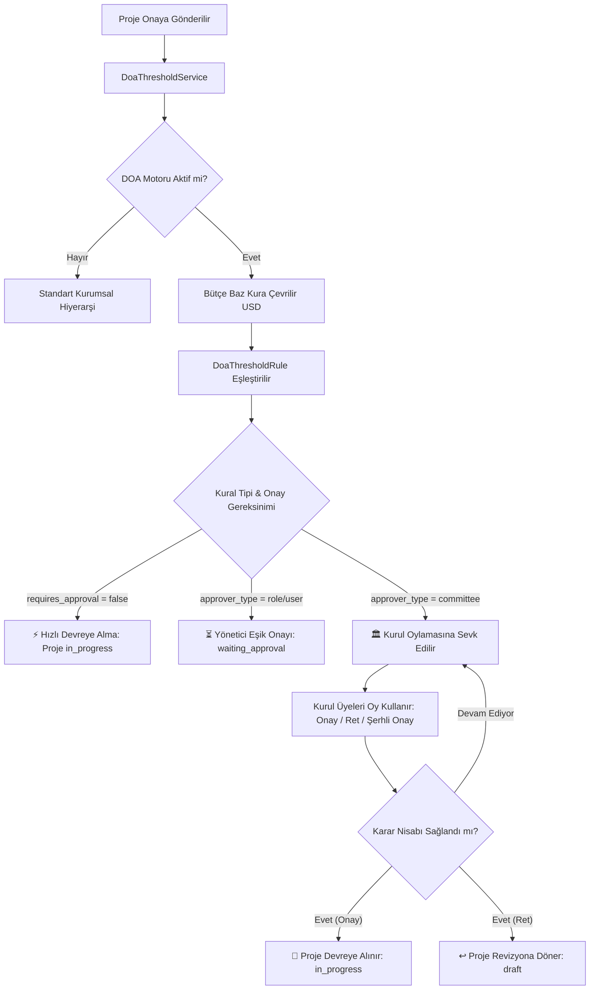

# Dinamik Bütçe Onay Kademeleri (DOA Matrix) & Kurul Yönetimi Geliştirme Özeti (Walkthrough)

Bu doküman, Köksan Enterprise PPM sistemi için geliştirilen **Dinamik Yetki Devri (DOA Matrix)**, **Çok Kademeli Bütçe Eşik Motoru**, **Kurullar & Karar Oylama Meclisleri** ve bunların mevcut yetki, bildirim ve denetim logu matrisleriyle tam entegrasyonunu özetler.

---

## 1. Mimari Genel Bakış

---

## 2. Neler Yapıldı?

### 1. Veritabanı ve Modeller (Faz 1)
- **`committees` & `committee_members`**: Kurullar, karar oylama tipleri (`majority`, `unanimous`, `single_any`, `quorum_percentage`) ve üyelerin oy ağırlıkları.
- **`doa_threshold_rules`**: Sınırsız sayıda bütçe kademesi (`min_amount`, `max_amount`, `currency_code`, `requires_approval`, `approver_type`, `priority_order`, `is_active`).
- **`project_approval_requests`**: **Tarihsel Değişmezlik / Snapshot**: O an yürürlükte olan bütçe kuralının tam bir kopyası (`rule_snapshot`) JSON olarak kaydedilir. Kural sonradan değişse de geçmiş onaylar asla bozulmaz.
- **`committee_votes`**: Kurul üyelerinin gerekçeli oyları (`approve`, `reject`, `conditional_approve`, `abstain`) ve oy ağırlıkları.

### 2. İş Mantığı & No-Code Servisleri (Faz 2)
- **`DoaThresholdService`**:
  - `isEngineActive()`: Global aç/kapa kontrolü.
  - `convertToBase()`: Sistem aktif döviz kurları ile dinamik kur çevrimi.
  - `matchRule()`: Öncelik sırasına göre en uygun kademeyi tespit etme.
  - `submitProjectForApproval()`: Snapshot üretip onay sürecini yönetme veya doğrudan devreye alma.
- **`CommitteeVotingService`**:
  - `recordVote()`: Üye oylarını kaydetme ve karar yeter sayısını hesaplama.
  - `evaluateDecision()`: Karar kesinleştiğinde projeyi otomatik olarak devreye alma (`in_progress`) veya revizyona döndürme (`draft`).

### 3. Matris, Bildirim ve Log Entegrasyonları (Faz 3)
- **Bildirim & Mail Matrisi (`NotificationMatrix`)**:
  - `proje_kurul_oylamasina_dustu`: Kurul üyelerine bildirim ve oylama çağrısı.
  - `proje_kurul_karar_verildi`: Karar kesinleştiğinde tüm paydaşlara bilgilendirme.
  - `proje_doa_esik_onayi`: Eşik sahibine (GM/CEO) onay bildirimi.
  - `proje_hizli_onaylandi`: Doğrudan devreye alınan projeler için bilgilendirme.
  - Dinamik alanlar kurallar gereği **KALIN** (`**{proje_adi}**`, `**{kurul_adi}**`, `**{tutar}**`) formatlanmıştır.
- **Yetki Matrisi (`permission_matrix`)**:
  - `manage_doa_rules`, `manage_committees`, `vote_in_committee`, `view_doa_rules` izinleri rollere bağlandı.
- **Log Görünürlük Matrisi (`AuditLogController`)**:
  - `doa` ve `kurul` kategorileri `/admin/denetim-loglari` matrisine eklendi.
  - **Developer Gizliliği**: Developer (`superadmin`, ID 1) loglarını **SADECE DEVELOPER** görür.
  - **Admin Görünürlüğü**: Admin (`admin`, ID 20) loglarını **ADMIN, DEVELOPER ve YÖNETİM** görür.

### 4. Admin Yönetim Arayüzleri (Faz 4)
- **`/admin/doa-esikleri`**:
  - Global DOA Motoru Aç/Kapa anahtarı.
  - Eşik kademeleri tablosu (Öncelik, Tutar Aralığı, Onaycı Tipi, Aktif/Pasif switch'i).
  - Canlı Simülatör (Tutar, Para Birimi, Kategori girerek hangi kuralın tetikleneceğini test etme).
  - Yeni Eşik Ekleme ve Düzenleme modalları.
- **`/admin/kurullar`**:
  - Kurul oluşturma, oylama modeli seçimi ve karar nisabı yüzdesi.
  - Kurul üyeleri listesi (Başkan, Üye, Raportör, Oy Katsayısı).
  - Üye ekleme / çıkarma / aktif-pasif modalları.
- **Sister Tabs Çubuğu**: Tüm matrisler arasında (`Roller`, `Kullanıcı Rolleri`, `Yetki Matrisi`, `Bildirim Matrisi`, `Bütçe Eşikleri`, `Kurullar`, `Log Görünürlüğü`) tek tıkla geçiş.

### 5. Proje Detay Ekranı ve Kurul Oylama Paneli (Faz 5)
- **`/projects/{id}`**:
  - Kurul oylaması devam eden projelerde sayfanın en üstünde canlı **Kurul Oylama Paneli**.
  - İlerleme çubuğu (Onay %, Ret %), kullanılan oylar listesi.
  - Kurul üyelerine özel oy kullanma butonu (✓ Onayla, ⚠️ Şerhli Onay, ✕ Reddet) ve not alanı.
  - Yönetici onayındaki projelerde "✓ Bütçeyi Onayla ve Devreye Al" / "↩ Reddet" butonları.

---

## 3. Doğrulama ve Test Sonuçları (Faz 6)

`tests/doa_test.php` simülasyonu ile uçtan uca test edildi:

| Senaryo | Test Parametreleri | Beklenen Sonuç | Test Çıktısı | Durum |
| :--- | :--- | :--- | :--- | :---: |
| **Hızlı Devreye Alma** | 500 USD bütçe | `requires_approval = false` | Talep: `bypassed_auto`, Proje: `in_progress` | ✅ BAŞARILI |
| **Bölüm Lideri Eşiği** | 15.000 USD bütçe | Bölüm Lideri rol onayı | Kural: Bölüm Lideri Onay Kademesi | ✅ BAŞARILI |
| **Kurul Oylamasına Sevk** | 2.000.000 USD bütçe | Yatırım Kurulu oylaması | Proje: `waiting_approval`, Adım: "Yatırım Kurulu Oylaması Bekleniyor" | ✅ BAŞARILI |
| **Nisap & Karar Kesinleşme** | 2 üyeden 2 Onay | Karar onaylandı | Karar kesinleşti: Talep `approved`, Proje `in_progress` | ✅ BAŞARILI |
| **Snapshot Koruma** | Kural değişse dahi | Snapshot bozulmaz | `rule_snapshot` kilitlendi | ✅ BAŞARILI |
| **Developer Gizliliği** | Developer log filtre | Sadece developer görür | Normal roller developer loglarını göremez | ✅ BAŞARILI |
