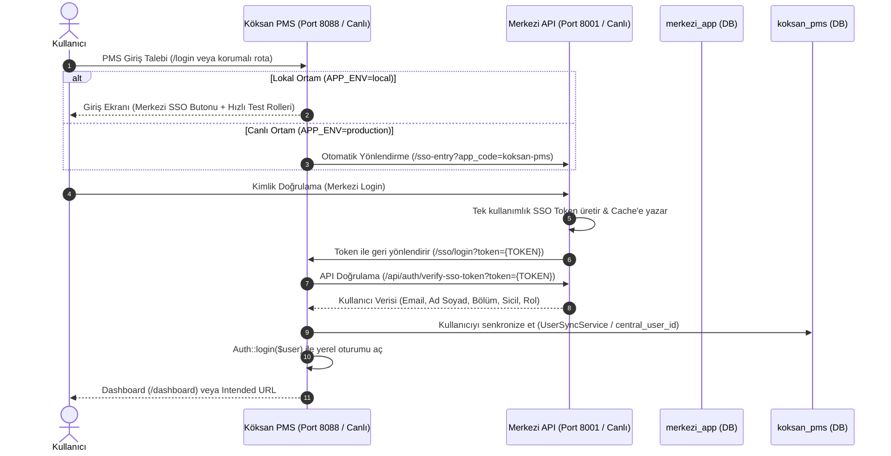

# Köksan PMS — Merkezi API SSO Entegrasyonu ve Canlıya Hazırlık Planı

Bu belge; **Köksan PMS (Proje Yönetim Sistemi)** projesinin **Merkezi API (Merkezi Yönetim Sistemi Core)** ile SSO (Single Sign-On / Tek Noktadan Giriş) entegrasyonunun tamamlanması, lokal geliştirme ortamında rol test araçlarının korunup canlı ortamda (`production`) gizlenmesi, Merkezi API tarafındaki uygulama kaydının yapılması ve projenin GitHub (`https://github.com/koksanopex-creator/proje`) üzerinden sunucu canlı ortamına alınması adımlarını kapsar.

---

## 1. Mimari Genel Bakış ve SSO Akışı

---

## 2. Geliştirme (Local) vs. Canlı (Production) İzolasyonu

Kullanıcı kuralı gereğince:
1. **Lokal / Geliştirme Ortamı (`APP_ENV=local`):**
   - Üst bardaki **"🎭 Hızlı Rol Testi"** dropdown'ı ve `switch-user/{id}` simülatörü geliştirme kolaylığı için aktif kalır.
   - Giriş ekranında hem tek tıkla test kullanıcıları hem de **"Merkezi API ile Giriş Yap"** butonu bulunur.
2. **Canlı Ortam (`APP_ENV=production`):**
   - Üst bardaki "🎭 Hızlı Rol Testi" seçicisi **KESİNLİKLE GİZLENİR** (`@if(app()->environment('local', 'development', 'testing'))`).
   - `/switch-user/{id}` rotası canlıda `abort(403, 'Bu işlem sadece yerel geliştirme ortamında kullanılabilir.')` döner.
   - Doğrudan `/login` rotasına gelen kullanıcılar otomatik olarak Merkezi API SSO kapısına (`/sso-entry?app_code=koksan-pms`) yönlendirilir.

---

## 3. Merkezi API Tarafı Entegrasyonu

Merkezi API (`C:\Users\celal.karaman\Desktop\Merkezi_API`) üzerinde:
1. `applications` tablosuna `koksan-pms` kaydının eklenmesi:
   - `code`: `koksan-pms`
   - `name`: `Köksan PPM (Proje Portföy Yönetimi)`
   - `url`: `http://localhost:8088` (canlıda sunucu adresi)
   - `icon`: `fa-diagram-project`
   - `is_active`: `1`
   - `requires_approval`: `0`
2. İlgili migrasyon / seeder dosyasının Merkezi API'de oluşturulması.
3. *Kural:* Değişiklik yapılan dosyalar IDE sekmesinde görüntülenebilecek şekilde kullanıcıya doğrudan iletilir.

---

## 4. Köksan PMS Tarafı Entegrasyonu

1. **Veritabanı Katmanı:**
   - Migration: `users` tablosuna `central_user_id` (bigInteger, nullable, indexed) eklenmesi.
2. **Konfigürasyon Katmanı:**
   - `.env` ve `config/services.php`:
     - `CENTRAL_SSO_URL=http://localhost:8001`
     - `CENTRAL_SSO_APP_CODE=koksan-pms`
3. **Controller Katmanı (`App\Http\Controllers\Auth\SsoController`):**
   - `login(Request $request)`: Token doğrulaması, `UserSyncService` ile kullanıcı senkronizasyonu ve `Auth::login()`.
   - `logout(Request $request)`: Yerel oturumu sonlandırıp Merkezi API `/global-logout` kapısına yönlendirme.
   - `redirect()`: Merkezi API `/sso-entry` kapısına yönlendirme.
4. **Görünüm Katmanı:**
   - `resources/views/layouts/app.blade.php`: Hızlı rol seçicinin ortama göre filtrelenmesi.
   - `resources/views/auth/login.blade.php`: Merkezi SSO butonu ve canlıda otomatik yönlendirme.

---

## 5. GitHub & Canlı Sunucu Dağıtım Yol Haritası

1. **GitHub Remote Ayarı:**
   - Hedef Repo: `https://github.com/koksanopex-creator/proje`
   - Mevcut remote'un güncellenmesi ve kullanıcı onayı ile ilk push'a hazır hale getirilmesi.
2. **Sunucu Canlı Ortamı Hazırlığı:**
   - Canlı URL: `https://kys.koksan.com/proje` (veya belirlenecek alt alan adı).
   - Nginx konfigürasyonu ve PHP-FPM soketi.
   - Sunucu `.env` ayarları (`APP_ENV=production`, `APP_DEBUG=false`, `CENTRAL_SSO_URL=https://kys.koksan.com/merkezi_yonetim_sistemi`).
