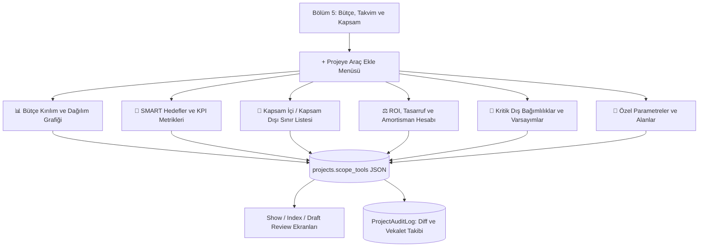

# Köksan PMS — Modüler Proje Kapsam Araçları & Widget Sistemi Uygulama Planı

Bu belge, Köksan Proje Yönetim Sistemi (PMS) bünyesinde yer alan **Yatırım Bütçesi, Takvim & Kapsam** bölümünün sadece düz metinden ibaret kalmayıp; kullanıcının dilediğinde projeye ekleyip çıkarabileceği **etkileşimli kurumsal araçlar (widgets & modular blocks)** ile zenginleştirilmesi, bu araçların `show`, `index`, `create`, `edit` ve `taslak (draft review)` ekranlarına entegrasyonu ve tüm ekleme/düzenleme/silme hareketlerinin vekalet denetimi dahil loglanması için hazırlanmıştır.

---

## 1. Mimari Genel Bakış ve Modüler Araç Sistemi

Projelerin kapsam ve fizibilite süreçlerini endüstriyel standartlara taşımak için 6 temel modüler araç tanımlanacaktır:

### 1.1. Tanımlanan Araçlar ve İşlevleri
1. **📊 Bütçe Dağılım & Harcama Grafiği (Donut / Bar Chart):**
   - Kalem kalem girilen veya kategorize edilen harcamaları Chart.js tabanlı canlı pasta/halka grafiği ile görselleştirir.
2. **🎯 SMART Hedefler & KPI Metrikleri Bloğu:**
   - Sayısal hedefler, başlangıç ve hedef değerler, ölçü birimi (%, kg, sn, adet) ve dinamik başarı ilerleme çubuğu.
3. **📌 Kapsam İçi / Kapsam Dışı Sınır Listesi (In-Scope vs. Out-of-Scope):**
   - Endüstriyel projelerde kapsam kaymasını (Scope Creep) önleyen; bu fazda onaylanan işler ile kesinlikle hariç tutulan maddelerin 2 sütunlu şık paneli.
4. **⚖️ Fizibilite, Tasarruf & ROI (Geri Dönüş Süresi) Hesaplayıcı:**
   - Yatırım tutarı ve beklenen yıllık tasarruf/katkı üzerinden otomatik amortisman süresi (yıl/ay) ve yıllık ROI hesaplayan finansal analiz kartı.
5. **🔗 Kritik Dış Bağımlılıklar & Varsayımlar:**
   - Tedarikçi teslimatları, gümrük süreçleri, trafo/enerji onayları veya fabrika duruş izinleri gibi kritik dış bağımlılıkların termin ve sorumluları.
6. **🧩 Dinamik Özel Parametreler (Custom Fields):**
   - Kullanıcının projeye özel istediği etiket ve değerde ek parametreler tanımlayabilmesi (Örn: Makine Seri No, Hedeflenen CO2 Azaltımı vb.).

---

## 2. Veritabanı ve Model Katmanı

1. **Migration (`add_scope_tools_to_projects_table`):**
   - `projects` tablosuna `json('scope_tools')->nullable()->after('notification_settings')` kolonu eklenir.
2. **Model (`App\Models\Project`):**
   - `$fillable` dizisine `scope_tools` eklenir.
   - `casts()` fonksiyonunda `'scope_tools' => 'array'` tanımlanır.
   - Kolay erişim için `hasScopeTool($toolKey)` ve `getScopeTool($toolKey)` yardımcı metodları eklenir.

---

## 3. Form Entegrasyonu (`create.blade.php` ve `edit.blade.php`)

* **Bölüm 5 Altında "Araç Ekle" Butonu:**
  - `🧩 Projeye Kapsam Aracı Ekle ▾` açılır menüsü.
  - Seçilen araç animasyonla ilgili bölüme eklenir; her aracın sağ üstünde `✕ Aracı Kaldır` butonu yer alır.
* **Mevcut Veriyle Açılış (`edit.blade.php`):**
  - Projede önceden tanımlanmış olan araçlar otomatik olarak açık ve dolu gelir.
* **Şablon Entegrasyonu:**
  - Şablondan klonlama yapıldığında, şablondaki araçlar (KPI'lar, kapsam sınırları) projeye kopyalanır.

---

## 4. Gösterim Katmanı (`show.blade.php`, `index.blade.php` ve `external_draft_review.blade.php`)

1. **Proje Detay Sayfası (`projects/show.blade.php`):**
   - Projede hangi araçlar aktifse, Kapsam ve Bütçe sekmesinde modern kurumsal kartlar ve grafikler olarak render edilir.
   - Örneğin KPI'lar için ilerleme çubukları, bütçe için renkli donut grafik, kapsam için yeşil/kırmızı sınır kartları.
2. **Taslak İnceleme Sayfası (`projects/external_draft_review.blade.php`):**
   - Dış paydaşlar ve onaycılar taslağı incelerken tüm modüler araçları interaktif olarak görür.
3. **Proje Portföy Listesi (`projects/index.blade.php`):**
   - Proje kartlarında ve tablo satırlarında aktif araçları belirten mikro rozetler gösterilir:
     - `🎯 3 KPI` • `⚖️ 1.4 Yıl ROI` • `📌 Kapsam Sınırları`

---

## 5. Denetim İzi (Audit Log) & Vekalet Kuralları (Madde 11, 14, 15, 16)

* `ProjectService::updateProject` ve `createProject` metodlarında:
  - `scope_tools` üzerindeki değişiklikler (eklenen araç, silinen araç, değişen KPI veya ROI değerleri) algılanır.
  - Eski ve yeni değerler (`old_values['scope_tools']` & `new_values['scope_tools']`) JSON olarak saklanır.
  - Log açıklamasında: `Kapsam Araçları Güncellendi: 'SMART Hedefler & KPI' eklendi | 'Kapsam Sınırları' güncellendi` formatında açık Türkçe özet üretilir.
  - Eğer işlem bir vekil (delegate) tarafından yapıldıysa, Madde 16 gereği `acting_as_user_id` ve `"{vekil} tarafından {asil} adına"` ibaresiyle loglanır.
  - Denetim Logları ekranındaki **🔍 Eski / Yeni Veri Karşılaştırması** tablosunda değişen araç parametreleri kırmızı/yeşil olarak listelenir.
