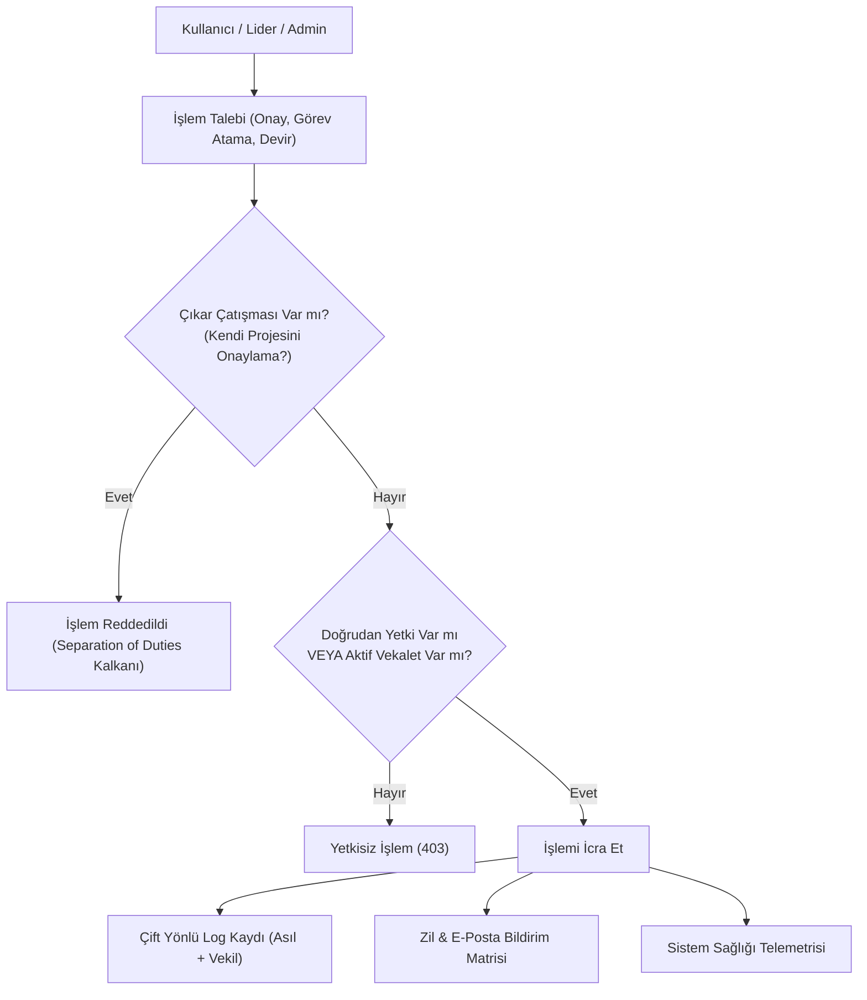

# KÖKSAN ENTERPRISE PPM
# PROJE İÇİ YETKİ MATRİSİ, GÖREV/ROL DEVRİ (HANDOVER) VE VEKALET SİSTEMİ MİMARİ UYGULAMA PLANI

**Doküman Kodu:** `PLN-DELEGATION-HANDOVER-2026-V1`  
**Tarih:** 19 Ekim 2026  
**Durum:** Onay Bekliyor (Review & Approval Pending)  
**Hedef Sistem:** Köksan Enterprise PPM (`koksan_pms`)  
**Temel İlke:** "Sıfır Hardcode, %100 Esnek Slug ve Matris Tabanlı Mimari, Katı Denetim İzi (Audit Trail)"

---

## 1. GİRİŞ VE STRATEJİK HEDEFLER

Bu mimari plan; organizasyonel gerçekleri (personel terfileri, işten ayrılma, yurt dışı görevlendirmeleri, yıllık izin ve hastalık durumları) ve saha-yönetim dengesini kurumsal bir çerçeveye oturtmak üzere hazırlanmıştır. 

Sistemde hiçbir unvan, rol veya kural **hardcode kodlanmayacak**; tüm süreçler dinamik **Yetki Matrisi**, **Bildirim Matrisi**, **Log Görünürlük Matrisi** ve **Sistem Sağlığı Teşhis Merkezi** üzerinden yönetilecektir.

### Temel 4 Sütun:
1. **Proje İçi Ekip Yetki Matrisi (Mikro Yetkilendirme & Çıkar Çatışması Kalkanı):**  
   Proje Lideri (`manager_id`) ve Superadmin/Admin, proje içindeki ekip üyelerine spesifik operasyonel izinler verebilir (`task_manage`, `meeting_plan`, `bom_manage`, `phase_report`, `file_manage`). Ancak "Separation of Duties" gereği hiçbir proje personeli kendi projesinin kurumsal bütçe onayını (DOA) veya İSG kapısını kendi kendine onaylayamaz.
2. **Personel Ayrılışı ve Görev/Rol Devri (Handover Wizard):**  
   Bir Proje Lideri, Sponsoru veya Ekip Üyesi projeden/işten ayrıldığında, pasife alınarak üzerindeki açık görevler, toplantı aksiyonları ve delege yetkileri ya mevcut bir ekip üyesine ya da dışarıdan projeye dahil edilecek yeni bir üyeye tek tıkla devredilebilir.
3. **Kullanıcı Vekalet Sistemi (User Deputyship / Proxy Delegation):**  
   Her kullanıcı (veya yönetim) belirli bir tarih aralığı ve kapsam için vekil atayabilir. Vekil işlem yaptığında sistem bunu *"Ahmet Yılmaz adına vekaleten Mehmet Demir tarafından onaylandı"* şeklinde açık ve çift taraflı loglar; `rules1.md` Madde 16 gereği arayüzde dinamik kalın ad gösterilir.
4. **Proje Ortasında Proje Liderini Değiştirme (Manager Succession):**  
   Superadmin ve Sponsor, projenin gidişatına göre proje liderini resmi devir logları ve bildirimlerle değiştirebilir.

---

## 2. VERİTABANI MODELİ VE ŞEMA TASARIMI

### 2.1. `project_stakeholder_permissions` (Proje İçi Delege Yetkileri Tablosu)
Proje liderinin ekip üyelerine verdiği projeye özel operasyonel yetkileri tutar.

| Sütun Adı | Veri Tipi | Kısıtlar / Varsayılan | Açıklama |
| :--- | :--- | :--- | :--- |
| `id` | `unsignedBigInteger` | Auto Increment, PK | Kayıt ID |
| `project_id` | `unsignedBigInteger` | Indexed, FK -> `projects.id` (cascade) | İlgili Proje |
| `user_id` | `unsignedBigInteger` | Indexed, FK -> `users.id` (cascade) | Yetkilendirilen Personel |
| `permission_key` | `string(64)` | Indexed | `task_manage`, `meeting_plan`, `bom_manage`, `phase_report`, `file_manage` |
| `is_granted` | `boolean` | default(true) | Yetki verildi mi? |
| `granted_by` | `unsignedBigInteger` | Nullable, FK -> `users.id` (set null) | Yetkiyi veren kullanıcı (Lider/Admin) |
| `created_at` / `updated_at` | `timestamps` | - | Zaman damgaları |

*Benzersizlik İndeksi:* `UNIQUE(project_id, user_id, permission_key)`

---

### 2.2. `user_delegations` (Kullanıcı Kurumsal Vekalet Tablosu)
Personellerin birbirine bıraktığı vekalet sözleşmelerini tutar.

| Sütun Adı | Veri Tipi | Kısıtlar / Varsayılan | Açıklama |
| :--- | :--- | :--- | :--- |
| `id` | `unsignedBigInteger` | Auto Increment, PK | Vekalet ID |
| `delegator_id` | `unsignedBigInteger` | Indexed, FK -> `users.id` (cascade) | Vekalet Bırakan (Asıl Yetkili) |
| `delegatee_id` | `unsignedBigInteger` | Indexed, FK -> `users.id` (cascade) | Vekil Tayin Edilen |
| `starts_at` | `dateTime` | Zorunlu | Başlangıç Tarihi & Saati |
| `ends_at` | `dateTime` | Zorunlu | Bitiş Tarihi & Saati |
| `scope` | `json` | default('["all"]') | Kapsam: `approvals`, `tasks`, `meetings`, `all` |
| `notes` | `string(255)` | Nullable | Vekalet Sebebi (Yıllık İzin, Yurt Dışı vb.) |
| `is_active` | `boolean` | default(true) | Aktiflik Anahtarı (Erken sonlandırma için) |
| `created_by` | `unsignedBigInteger` | Nullable, FK -> `users.id` (set null) | Kaydı açan (Kendi veya Admin) |
| `created_at` / `updated_at` | `timestamps` | - | Zaman damgaları |

*Kontrol Kuralı:* `delegator_id != delegatee_id` (Kişi kendine vekalet veremez, döngüsel vekalet engellenir).

---

### 2.3. `project_stakeholders` Tablosuna Eklenecek Alanlar (Görev & Rol Devri İçin)

| Sütun Adı | Veri Tipi | Kısıtlar / Varsayılan | Açıklama |
| :--- | :--- | :--- | :--- |
| `is_active` | `boolean` | default(true) | Ekipte halen aktif mi? |
| `left_at` | `dateTime` | Nullable | Projeden ayrılış tarihi |
| `left_reason` | `string(255)` | Nullable | Ayrılma sebebi (İşten çıkış, bölüm transferi, yurt dışı vb.) |
| `handover_to_user_id` | `unsignedBigInteger` | Nullable, FK -> `users.id` (set null) | Görevlerini devralan yeni üye |

---

## 3. ESNEK MATRİS ENTEGRASYONLARI (SIFIR HARDCODE)

### 3.1. Dinamik Yetki Matrisi (`/admin/yetki-matrisi`)
Yeni slug'lar `permissions` tablosuna `group_name` bazlı eklenecek ve admin arayüzünden açılıp kapatılabilecektir:

1. `project.manage_team_matrix`  
   *Adı:* Proje İçi Ekip Yetki Matrisini Yönetme  
   *Grup:* Proje Yönetimi  
   *Varsayılan Açık Roller:* Superadmin, Admin, Proje Yöneticisi
2. `project.handover_member`  
   *Adı:* Ayrılan Ekip Üyesinin Görev/Rollerini Devretme  
   *Grup:* Proje Yönetimi  
   *Varsayılan Açık Roller:* Superadmin, Admin, Proje Yöneticisi
3. `delegation.create`  
   *Adı:* Kendi Adına Kurumsal Vekalet Verme  
   *Grup:* Kullanıcı & Vekalet  
   *Varsayılan Açık Roller:* Tüm Roller (Superadmin, Admin, Direktör, Bölüm Lideri, Proje Yöneticisi, Mühendis/Kullanıcı)
4. `delegation.manage_all`  
   *Adı:* Başkası Adına Vekalet Tanımlama / İptal Etme  
   *Grup:* Kullanıcı & Vekalet  
   *Varsayılan Açık Roller:* Superadmin, Admin
5. `project.change_manager`  
   *Adı:* Proje Liderini Proje Ortasında Değiştirme  
   *Grup:* Proje Yönetimi  
   *Varsayılan Açık Roller:* Superadmin, Admin, Proje Sponsoru

---

### 3.2. Dinamik Bildirim Matrisi (`/admin/bildirim-matrisi`)
`notification_templates` ve `notification_matrix` tablolarına tam uyumlu yeni şablonlar (Rules1.md Madde 17 kalın dinamik değişken kuralına uygun):

| Olay Anahtarı (`event_key`) | Başlık | Zil Bildirim Şablonu | E-Posta Şablonu |
| :--- | :--- | :--- | :--- |
| `proje_yetki_delege_edildi` | Projede Yeni Yetki Tanımlandı | **{islem_yapan}** tarafından **{proje_kodu}** projesinde size **{yetki_adi}** yetkisi tanımlandı. | Sayın <strong>{kullanici_adi}</strong>, <strong>{islem_yapan}</strong> tarafından <strong>{proje_kodu} - {proje_adi}</strong> projesinde adınıza <strong>{yetki_adi}</strong> operasyonel yetkisi verilmiştir. |
| `uye_gorev_devri_yapildi` | Proje Görevleri ve Rolü Size Devredildi | **{ayrilan_kullanici}** kullanıcısının **{proje_kodu}** projesindeki görev ve yetkileri **{islem_yapan}** tarafından size devredildi. | Sayın <strong>{kullanici_adi}</strong>, <strong>{islem_yapan}</strong> tarafından <strong>{proje_kodu} - {proje_adi}</strong> projesinde <strong>{ayrilan_kullanici}</strong> üzerindeki <strong>{gorev_sayisi}</strong> adet görev ve roller size aktarılmıştır. |
| `vekalet_verildi` | Adınıza Kurumsal Vekalet Bırakıldı | **{vekalet_veren}**, **{baslangic_tarihi}** - **{bitis_tarihi}** tarihleri arasında size vekalet verdi. | Sayın <strong>{kullanici_adi}</strong>, <strong>{vekalet_veren}</strong> kullanıcısı <strong>{baslangic_tarihi}</strong> ile <strong>{bitis_tarihi}</strong> tarihleri arasında sistemsel işlemler için sizi vekil tayin etmiştir. Not: <em>{notlar}</em> |
| `vekaleten_islem_yapildi` | Vekaletiniz Kullanılarak İşlem Yapıldı | Vekiliniz **{vekil_adi}**, adınıza **{islem_adi}** işlemini onayladı/gerçekleştirdi. | Sayın <strong>{kullanici_adi}</strong>, Vekiliniz <strong>{vekil_adi}</strong> tarafından adınıza <strong>{proje_kodu}</strong> projesinde <strong>{islem_adi}</strong> işlemi gerçekleştirilmiştir. |
| `proje_lideri_degistirildi` | Proje Liderliği Size Devredildi | **{proje_kodu}** projesinin liderliği **{islem_yapan}** tarafından size devredilmiştir. | Sayın <strong>{kullanici_adi}</strong>, <strong>{proje_kodu} - {proje_adi}</strong> projesinin liderliği <strong>{islem_yapan}</strong> tarafından resmi olarak size devredilmiştir. |

---

### 3.3. Log Görünürlük Matrisi & Denetim Logları (`/admin/denetim-loglari`)
- Yeni Kategori: `'vekalet' => 'Vekalet, Görev & Rol Devri Logları'`
- Denetlenen Varlık Türleri: `UserDelegation`, `ProjectStakeholderPermission`, `ProjectStakeholderHandover`, `ProjectLeaderTransfer`
- `rules1.md` Madde 14 (Superadmin Maskeleme) ve Madde 16 (Başkası Adına İşlem Formatı):
  - Normal kullanıcılara: *"Ahmet Yılmaz adına vekaleten Mehmet Demir tarafından onaylandı."*
  - Superadmin arayüzünde: *"Ahmet Yılmaz adına vekaleten Mehmet Demir (Yönetim) tarafından onaylandı."*

---

### 3.4. Sistem Sağlığı Teşhis Merkezi (`/admin/sistem-sagligi`)
`SystemHealthService.php` içerisine 2 yeni otomatik tanı alt motoru eklenecektir:
1. **Proje İçi Yetki & Delege Matrisi Teşhisi:**
   - Projelerde tanımlı toplam delege izin sayısı.
   - Pasif olan personellerde kalmış yetim (orphaned) izin kontrolü.
   - Çıkar çatışması kalkanı doğrulaması (Proje lideri / üyesinin kendi projesinde DOA onaycısı olup olmadığı).
2. **Kurumsal Vekalet & Devir Sistemi Teşhisi:**
   - Aktif ve süresi devam eden vekaletler sayısı.
   - Süresi dolmuş ve sistem tarafından otomatik pasife çekilmesi gereken vekaletler.
   - Döngüsel vekalet tespiti (Örn: A kişisi B'ye, B kişisi A'ya vermiş mi kontrolü).

---

## 4. İŞ MANTIĞI VE SERVİS KATMANI MİMARİSİ

### 4.1. `DelegationService.php` (Vekalet Yönetim Servisi)
- `createDelegation(User $delegator, int $delegateeId, array $data, User $actor)`: Vekalet oluşturur, döngü kontrolü yapar, loglar ve bildirim üretir.
- `cancelDelegation(int $delegationId, User $actor)`: Vekaleti sonlandırır.
- `getActiveProxyFor(int $delegatorId, string $scope = 'all'): ?User`: Belirtilen kullanıcının şu anda aktif ve geçerli vekilini döndürür.
- `getDelegatorsForUser(int $userId, string $scope = 'all'): Collection`: Kullanıcının şu an adına işlem yapabileceği kişilerin listesini döner.

### 4.2. `ProjectStakeholderService.php` (Genişletilmiş Metotlar)
- `toggleStakeholderPermission(Project $project, int $userId, string $key, bool $state, User $actor)`: Proje içi izin anahtarını günceller.
- `handoverMember(Project $project, int $fromUserId, int $toUserId, array $options, User $actor)`:
  - `fromUser`'ı pasife alır (`is_active = false`, `left_at = now()`).
  - Açık görevleri (`ProjectTask`) `toUser`'a reassign eder.
  - Varsa proje içi yetkilerini (`ProjectStakeholderPermission`) aktarır.
  - Stakeholder rolünü günceller.
  - Bildirim ve denetim loglarını tetikler.
- `changeProjectManager(Project $project, int $newManagerId, bool $keepOldAsMember, ?string $notes, User $actor)`:
  - Eski proje liderini regular member yapar veya pasife alır.
  - `project.manager_id`'yi günceller.
  - Bekleyen onay adımlarını yeni lidere yönlendirir.
  - Denetim kaydı ve bildirimleri ateşler.
- `hasStakeholderPermission(Project $project, User $user, string $key): bool`:
  - Superadmin veya Admin ise -> `true`
  - Proje Lideri (`manager_id === user->id`) ise -> `true`
  - `project_stakeholder_permissions` tablosunda `is_granted = true` ise -> `true`
  - Proje liderinin aktif vekili ise -> `true`
  - Aksi halde -> `false`.

---

## 5. KULLANICI ARAYÜZÜ (UI / UX) VE ETKİLEŞİM

1. **Proje Detay Sayfası (`projects/show.blade.php`):**
   - Yeni Sekme: **"👥 Ekip & Yetki Matrisi"**
   - Her ekip üyesi için yan yana modern switch butonları:
     - 📋 Görev Yönetimi
     - 📅 Toplantı Planlama
     - 💰 BOM & Harcama Girişi
     - 🚩 Faz & Kilometre Taşı Raporlama
     - 📁 Dosya & Doküman Yönetimi
   - Ekip listesinde her üyenin yanında: **"🔄 Görevi/Rolü Devret"** butonu.
     - Tıklandığında açılan şık modal:
       - *"Mevcut bir ekip üyesine devret"* VEYA *"Dışarıdan yeni bir kullanıcıyı ekibe kat ve devret"*.
       - Devredilecek unsurlar (Checklist): Açık Görevler, Proje İçi Yetkiler, RACI Rolü.
       - Ayrılma gerekçesi (İşten ayrılma, yurt dışı görev, bölüm değişimi).
   - Üst buton alanında (Sadece Superadmin & Sponsor için): **"👑 Proje Liderini Değiştir"** butonu ve devir modalı.

2. **Global Üst Bar (Topbar) & Kullanıcı Profili:**
   - Kullanıcı menüsüne: **"🛡️ Kurumsal Vekalet Bırak"** modal butonu.
   - Kullanıcı aktif bir vekalete sahipse veya bir başkasına vekalet vermişse üst barda zarif bir rozet (`badge`) gösterilir:
     - *"ℹ️ Ahmet YILMAZ adına vekaletiniz aktif (Bitiş: 25.10.2026)"*
   - Başkası adına işlem yaparken onay modalında:
     - **`rules1.md` Madde 16 gereği:** `<strong>Ahmet YILMAZ</strong> adına bu işlemi onaylayacaksınız.`

---

## 6. UYGULAMA VE DOĞRULAMA ADIMLARI

1. **Adım 1: Migrasyonların Oluşturulması ve Çalıştırılması**
   - `database/migrations/2026_10_19_000001_create_project_stakeholder_permissions_table.php`
   - `database/migrations/2026_10_19_000002_create_user_delegations_table.php`
   - `database/migrations/2026_10_19_000003_add_handover_fields_to_project_stakeholders.php`
   - `php artisan migrate`
2. **Adım 2: Modeller ve İlişkiler**
   - `ProjectStakeholderPermission.php`, `UserDelegation.php` modellerinin oluşturulması.
   - `Project.php`, `User.php`, `ProjectStakeholder.php` ilişkilerinin bağlanması.
3. **Adım 3: Matris Seeder'ı ve Dinamik Kayıtlar**
   - `ProjectDelegationMatrixSeeder.php` ile 5 yeni yetki, 5 yeni bildirim şablonu ve log kategorisinin yüklenmesi.
4. **Adım 4: Servis Katmanı ve İş Mantığı**
   - `DelegationService.php` oluşturulması.
   - `ProjectStakeholderService.php` genişletilmesi (devir, yetki kontrolü, lider transferi, SoD kalkanı).
5. **Adım 5: Controller & API Uç Noktaları**
   - `DelegationController.php` (Vekalet CRUD).
   - `ProjectController` içine yetki toggle, handover ve change_manager metotlarının bağlanması.
6. **Adım 6: UI / Blade Ekranları**
   - `projects/show.blade.php` Ekip & Yetki Matrisi sekmesi ve devir modalları.
   - `layouts/app.blade.php` vekalet modalı ve vekil rozeti.
   - `admin/audit_logs.blade.php` vekalet logları entegrasyonu.
   - `SystemHealthService.php` ve `admin/system_health.blade.php` tanı kartları.
7. **Adım 7: Canlı Doğrulama ve E2E Testler**
   - Tarayıcı subagent ve simülasyon testleriyle tüm senaryoların doğrulanması.

---
**Onayınızın ardından bu plan doğrultusunda Adım 1'den itibaren geliştirme başlatılacaktır.**
